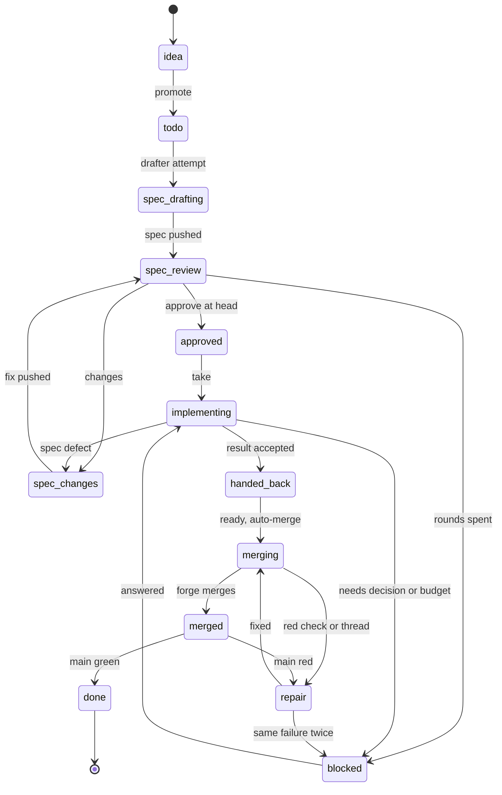

# v9: a deterministic coordinator

p1-v9-design-from-friction. Draft, 2026-10-30, from docs/plans/v9-friction.md, the person's
research reports (the itos and Open Orchestra comparison and the autonomous software factory
blueprint, kept outside the repository) and a read-only study of Open Orchestra's orchestration
source (jterratsdev/open-orchestra at 7fe4d97; design only: its package.json declares MIT but the
repository has no LICENSE file, so no code is ported until that is settled).

## Purpose

The person, 2026-10-30: the coordinator's workflow becomes deterministic, so any agent, or a
program, can replace the Claude Code session that coordinates today and behave the same. The state
machine lives in itos. A driver only asks itos for an item's next step, runs it, and asks again.

Today the steps are partly itos commands and partly judgement, and the rest is prose a session must
remember: the brief templates in `.git/itos/briefs/`, the recovery rules in `.git/itos/notes.md`
(bring a spec branch up to main, rerun `--ready` on exit 75, the clean-status fallback, the person's
`--onto-main`), "a report is a claim", and where each item stands. That prose is what v9 turns into
data and commands.

## Three designs, one model

- **Typed items** (p1-typed-items) say what an item is: its kind (idea, slice, task, bug) and
  fields.
- **The state machine** (p1-item-lifecycle) says how each kind moves; a docs task skips the review
  states a slice walks.
- **The VCS and tracker seams** (p2-vcs-and-tracker-seams) say where its facts come from.

The machine is defined over abstract facts, each bound to a candidate revision C, so a new
candidate makes every fact about the old one stale: `spec.proposed@S`, `spec.accepted@S`,
`claimed`, `change.proposed@C`, `change.reviewed@C`, `checks@C`, `change.accepted@C` (every fact
the item's kind requires holds at C), `landed@L` (C reachable from trunk's first parent),
`trunk.verified@L`, `blocked` (decision, budget, no progress) and `parked` (deferred, dropped).
`closed` is derived, never written: landed, verified and accepted for the latest candidate.

Adapters turn forge and VCS objects into facts. Under push.mode pr on GitHub, C is the pull
request's head and landing is its merge commit. Under push.mode trunk, C is a digest of the commits
on trunk's first parent whose `Item:` footer names the item, and proposing is landing. Fossil
(later) is trunk with autosync, which refuses a fork, so nothing is ever rebased. Only the gate
policy orders the facts differently:

- **pre-land** (pr): proposed, reviewed and checked, accepted, landed, verified, closed;
- **post-land** (trunk, Fossil): proposed = landed, checked, reviewed, accepted, closed; landed
  commits not yet reviewed are review debt, which gates the release or a feature flag, never the
  landing (p2-trunk-review-and-release).

The order of the work differs from the order of the design: the state machine is built first, in pr
mode, over the git and GitHub adapters itos has.

## Where state lives

- **Committed:** the registry's definitions (id, kind, title, why, depends_on, refs, the queue),
  the specs, decisions, and the terminal deferred and dropped.
- **Derived, never committed:** the status. Under pr: a draft pull request open means doing, a
  merged one with main green means done. Take and close stop being commits, so they cannot race the
  work, and what was built around that race goes: registry commits routed to main (slice-192),
  inferring done from merges (slices 195, 199), bug-146's stuck close.
- **On the forge:** the pull request (draft, ready, head, merged), reviews, threads, checks, the
  assignee, and hidden-marker comments for the take, attempts and verdicts (as itos's review
  request marker already is).
- **Local, only before a pull request exists:** a per-clone attempt journal under `.git/itos/`.

## The machine

| From → to                        | Actor                                                           | Command                                                      | Outcomes                                       |
| -------------------------------- | --------------------------------------------------------------- | ------------------------------------------------------------ | ---------------------------------------------- |
| idea → todo                      | person, or the answering agent in a delegated class             | `work promote` (exists)                                      | promoted, already, refused                     |
| todo → spec drafting             | drafter                                                         | `itos brief --role drafter`, `itos attempt submit` (new)     | accepted, rotated, stale, scope-mismatch       |
| spec drafting → spec review      | derived                                                         | the pull request holds the spec commits                      |                                                |
| spec review → approved / changes | reviewer                                                        | `itos review post --verdict … --head <sha>` (new)            | approved, changes, head-moved, already         |
| changes → spec review            | drafter                                                         | `push`, `push thread --reply --resolve` (exist)              | as push; past N rounds, blocked                |
| approved → implementing          | driver                                                          | `work take`, a marker, no commit                             | taken, already, owned-by-other                 |
| implementing → handed back       | implementer                                                     | `itos brief --role implementer`, `itos attempt submit`       | accepted, rotated, needs-decision, spec-defect |
| handed back → merging            | driver                                                          | `push --ready`: ready, auto-merge pinned to the head, return | handed-to-forge, already, threads-unresolved   |
| merging → repair                 | derived: a red check at the head, a new thread                  |                                                              |                                                |
| repair → merging                 | implementer                                                     | fix, `push` (merges main in), `push --ready`                 | as above                                       |
| merging → merged                 | the forge                                                       | observed                                                     |                                                |
| merged → done                    | derived: merged and main green                                  | nothing to run                                               |                                                |
| merged → repair                  | derived: main red at the merge                                  | a revert, `work give-back` (exists)                          |                                                |
| any → blocked                    | an LLM's needs-decision, a spent budget, the same failure twice | `decision add --item` (exists)                               | added, already                                 |
| blocked → back                   | the answering agent (delegated class) or the person             | `decision answer`, `--provisional --class` (new)             | answered, already, class-not-delegated         |
| any → deferred / dropped         | the person                                                      | `work defer`, `work drop` (exist)                            | terminal: later moves are stale                |



### A path per kind

R is required, C required only for the classes the config names (ADR-0061's high blast radius as
data), – skipped. The paths are config, one row per type, read by `itos next`, so a typo fix does
not walk seven states. Typing an idea keeps its id (p1-typed-items): an outside driver joins on ids.

| Step                             | idea         | slice (feat)        | bug (fix)                    | task (other types)           |
| -------------------------------- | ------------ | ------------------- | ---------------------------- | ---------------------------- |
| spec                             | – (a why)    | `@wip` scenarios, R | one `@bug-n` scenario, R     | a ledger entry's checks, R   |
| spec review                      | –            | R                   | C (R when it touches a gate) | C (R for gate, policy)       |
| claim                            | –            | R                   | R                            | R                            |
| red first (a test commit before) | –            | R                   | R                            | – (checks may pass before)   |
| change review                    | –            | C                   | C                            | C; none for a typo-level doc |
| checks                           | –            | scenarios and CI    | its scenario and CI          | its checks and CI            |
| accept, land, verify             | –            | R                   | R                            | R                            |
| exit                             | typed/parked | closed              | closed                       | closed; its checks retire    |

### Landing under pr

`itos push` on an item branch merges `origin/main` in whenever the branch lacks main's head, never a
rebase; a conflict is an ordinary commit by the implementer. The pull request lands with
`--merge --match-head-commit C` through auto-merge, its message written by itos (`<item>: <title>`
and an `Item:` footer), so a first-parent reader never parses the branch for the item. `verify` and
`ci range` walk first parents and judge each landing's second-parent side per commit. An item's
change is `git show --diff-merges=first-parent <merge>`; its commits `git log <merge>^1..<merge>^2`.

### Rerun safety (p1-mutations-rerun-safe)

Every mutating command takes `--expect <revision>`, the digest `itos next` returned: a stale one is
`stale` with no effect; a target already in the asked state is `already` (exit 0); a lost answer is
`effect-uncertain` with what to observe. Recovery is always "ask `itos next` again".

### `itos next <item> --json`

A pure function of the definitions, one forge query per item (the reviews, threads and comments
query `--ready` uses, with checks and markers), open decisions and main's CI:

```
{"schema":1,"item","state","revision",
 "observed":{"main","pr":{…},"verdicts","threads_open","ci":{…},"decisions_open","attempt":{…}},
 "next":{"actor":"driver|drafter|reviewer|implementer|answerer|person|forge","argv":[…],"attempts_left":n},
 "blocked_reason"?:"decision|budget|no_progress|deferred"}
```

A `forge` actor means wait (`ci watch`, or yield); a `person` actor halts that item alone. The same
failure fingerprint (failed step and first error line) twice blocks the item.

### The LLM steps' contracts

- **In:** `itos brief <item> --role <r> --json` (p1-guide-brief-filled): the request id (a hash of
  item, role, attempt, base and spec digest), the spec commit, a manifest of reads with blob shas and
  what was left out, the settled decisions, the allowed commands, the result's path and schema, and
  the repository's brief lines as data.
- **Out:** strict JSON with exactly the expected keys and an outcome of done, blocked,
  needs_decision or spec_defect, plus the role's fields (the implementer's head, commits, the failing
  step before the work).
- **Checked before advancing:** the identity echoed (else stale or scope-mismatch, no rotation), the
  schema (malformed rotates the attempt, within budget), and the claims against git and the forge:
  the head is on the remote, a test commit precedes the feat or fix, the scenarios are live, a
  verdict exists at that head. Prose never decides a move.

## What is piloted on v8, what needs v9

v8 builds only what v9 keeps. Additive, so on v8: `itos next`, `itos brief`, `itos attempt submit`,
`itos review post`, `--expect` with `already` and `stale`, `decision answer --provisional`, and a
hand-off mode of `--ready` beside the blocking one, and the kind paths as config whose default is
today's flow. In v8, `itos next` reads claimed and closed from the registry, and the pilot drives
today's commands (take and close still commit, item branches still rebase: merge-in would contradict
v8's released merge-in-history refusal). The pilot driver is a Claude Code workflow script holding
nothing but a switch on `next.actor`; a Go driver follows once `next` is stable. v9 then swaps the
effects underneath while `next`'s contract stays, so the driver does not change between the two.

v9 removes or changes what is released: take and close as commits, the blocking `--ready`,
`--onto-main` and pre-push's counterpart rule, rebasing an item branch (merge main in instead), the
exit codes and JSON contract (q-89, ADR-0053, p1-cli-kong), typed items, and the seams.

## From Open Orchestra

Adopted as design: the resumable step function with a stop reason and a next action (`itos next`);
an expected revision with a replay digest (an exact replay is a no-op, a stale write a conflict); the
content-addressed request and result with attempt binding and rotation on a malformed result; the
program checking what a result cites; a hashed context manifest (the brief); gates as data
(delegated decision classes); no revival of a terminal state; one corrective action at a time.

Rejected: a local lock journal as the authority (git and the forge arbitrate across clones); state
and events written apart; lenient parsing of LLM output; unbounded attempts; regex checks of
handoff text as proof; done persisted before the final check; heuristic routing; a fixed sequence
of six roles.

## Open questions

Each with the coordinator's recommendation; the person decides.

1. **Merge commits (friction question 3).** Branches take main by merge, pull requests land as
   merge commits, history is read by first parent (`git log --first-parent`; an item's change is
   `git show --diff-merges=first-parent <merge>`). Recommended; trunk mode avoids it entirely.
2. **Message checks at push (friction question 4).** Commits free locally, amend included; the
   range judged at `itos push` and in CI. Open: the person has a doubt not yet stated.
3. **Attempt and verdict records:** pull request markers, a local journal only before the pull
   request exists, never commits.
4. **Who runs `--ready`:** the driver, since it no longer judges or waits.
5. **Trunk mode's status** has no pull request to derive from: pilot pr mode first; trunk keeps
   committed status until p1-github-registry-pilot decides where it lives.
6. **Codex gating auto-merge:** a CI job reading the review state for the head posts a required
   check, beside GitHub's conversation-resolution rule.
7. **A task's checks once done is never committed:** they retire when the item is derived done;
   pruning the ledger is a periodic docs commit the person approves (ADR-0043's intent).
8. **Budgets:** two attempts per role per state, three review rounds, the same failure twice blocks;
   configurable.
9. **Delegated decision classes** (p1-decision-delegated-classes): first spec ambiguities inside an
   item's scope and drafter-reviewer disputes; gates, policy, breaking changes and sign-offs stay the
   person's.
10. **Who coordinates:** the pilot driver is a Claude Code workflow script; Open Orchestra is read for
    design only, and is never run outside a sandbox (p2-orchestra-pilot).
11. **A candidate under trunk:** the digest of the item's `Item:` footer set, which needs no state
    and carries over to Fossil's check-in comments.
12. **What review debt gates under trunk:** the release, and the feature flag where there is one;
    never the landing.
13. **A bug's spec review:** skipped by default, required when it touches a gate path; its scenario
    and red first are the evidence.
14. **The landing commit's message:** itos's, `<item>: <title>` with an `Item:` footer.
